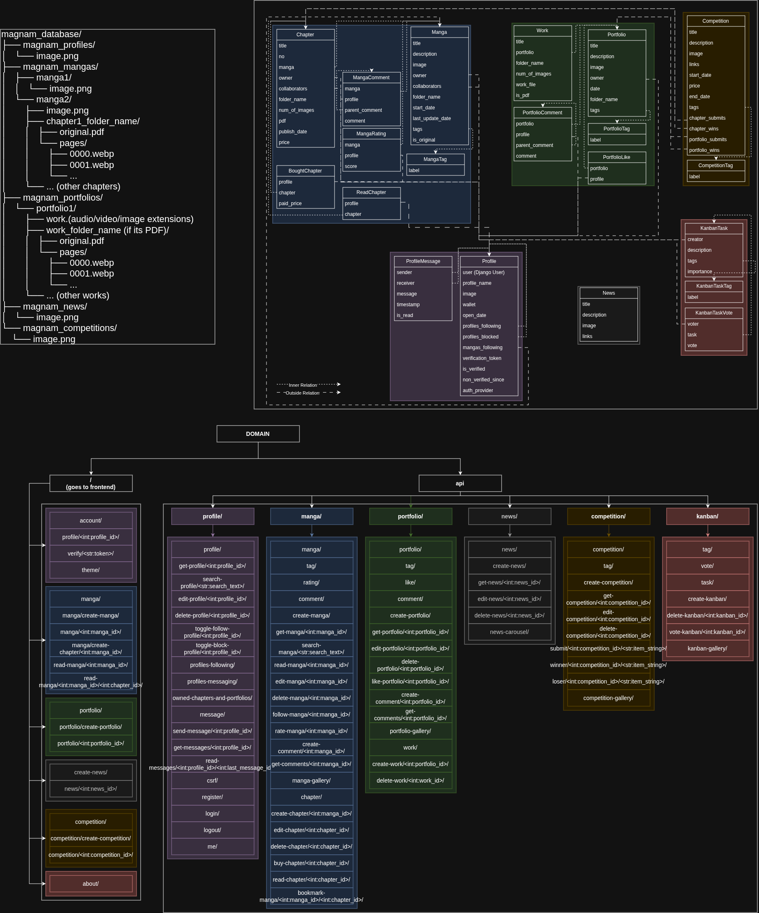

# MaGNaM

MaGNaM is a platform that aims to help users publish their works and collab more easily by allowing them publish their work, display their portfolios, compete in competitions and look for collaborations and keep up with the latest news.

The project is a single‑code‑base Django + React stack, deployable on Hetzner Cloud VPS with Cloudflare for DNS and Cloudflare R2 for media storage.

---

## Architecture Overview

| Layer | Technology | Additional Notes |
|-------|------------|---------|
| **Backend** | Django (ASGI) + Channels (WebSockets) |
| **Frontend** | React + Webpack |
| **Database** | PostgreSQL |
| **Async worker** | Celery + Redis | PDF parsing, email sending (in the future) |
| **Reverse proxy** | Nginx → Daphne → Django | HTTPS termination, static file serving |
| **Object storage** | Cloudflare R2 (prod) / local filesystem (dev) |
| **Domain** | studiomagnam.com (Cloudflare) | Public DNS, rate limiting |

---

## Project Structure  
  
.  
├── magnam/  
│   ├── magnam/  
│   │   ├── settings/  
│   │   │   ├── base.py  
│   │   │   ├── development.py  
│   │   │   └── production.py  
│   │   ├── storage/ # local of R2 cloud storage providers  
│   ├── frontend/  
│   │   ├── src/  
│   │   │   ├── componentWrappers/ # component classes  
│   │   │   ├── context/ # react contexts  
│   │   │   ├── pages/ # frontend pages  
│   │   ├── urls.py  
│   │   ├── views.py  
│   │   └── webpack.config.js  
│   ├── google_auth/ # google oauth util function  
│   ├── NewsPageApp/  
│   ├── KanbanTaskPageApp/  
│   ├── PortfolioPageApp/  
│   ├── MangaPageApp/  
│   ├── CompetitionPageApp/  
│   ├── ProfilePageApp/  
│   ├── dev_to_prod_commands.sh # summarty of basic commands to run from migrating code from development to production machine  
│   ├── pull_to_deploy.sh # script to run at production server node to prepare for deploying new version  
│   ├── refresh_database.sh # cleans the local development and populates the database  
│   ├── security_check.sh # a command to go over the environment and packages to output a security check text  
├── designs_and_plans/  
├── dataset_population/ # dummy database population contents  



---

## Getting Started (Local Dev)

```bash
# 1. Create a virtual environment
python -m venv magnam_venv
source magnam_venv/bin/activate

# 2. Install backend deps
pip install -r requirements.txt

# 3. Install frontend deps
cd frontend
npm ci
cd ..

# 4. Apply migrations
python manage.py makemigrations
python manage.py migrate

# 5. Load sample data and refresh the environment (optional)
./refresh_database.sh

# 6. Run dev servers (or use DJANGO_SETTINGS_MODULE=magnam.settings.development DJANGO_ENV_FILE=.env.development daphne -b 127.0.0.1 -p 8000 magnam.asgi:application)
python manage.py runserver

# 6.5 prepare celery (only for PDF parsing async worker, optional in basic testing)
celery -A magnam -b 'redis://localhost:6379/0' purge -f; systemd-run --scope -p MemoryMax=2G -p CPUQuota=200% -p IOWeight=10 nice -n 10 celery -A magnam worker --loglevel=debug --concurrency=2

# 7. Frontend
cd frontend
npm run dev

# The backend runs on http://127.0.0.1:8000
```

---

# Unit & integration tests

```bash
python manage.py test
```


# Frontend lint & unit tests (not configured yet)
```bash
cd frontend
npm run lint
npm run test
```

---

# Production Deployment

All production workloads run on a Hetzner Cloud VPS.  

| Service          | Description                     |
|------------------|---------------------------------|
| magnam‑daphne    | ASGI server                     |
| magnam‑celery    | Celery beat + worker            |
| nginx            | Static files + reverse proxy    |
| redis‑server     | Celery backend                  |
| postgresql       | App data + daily backups        |

---

# Contributing (will be decided)
---